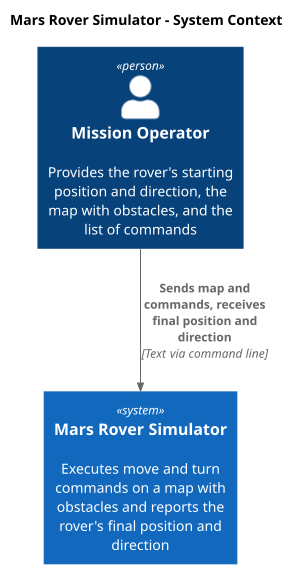

# 3. System Scope and Context

## 3.1 System Scope

The Mars Rover Simulator is a self-contained command-line program. It has no
network interfaces, no external services, and no persistent storage. Everything
it needs — the grid description, the rover's starting state, and the command
sequence — arrives in a single input file. Everything it produces goes to
stdout in the same process.

The system boundary contains exactly one process: the simulator itself. Outside
that boundary sits one actor and no external systems.

## 3.2 Context Diagram



## 3.3 Actors and External Systems

### Mission Operator (human actor)

The person who runs the simulator. They prepare the input file (grid size,
obstacle positions, rover starting state, command sequence) and read the
output. They interact with the system through the shell:

```
docker run --rm -v $(pwd)/mission.txt:/mission.txt rover /mission.txt
```

There are no other human actors and no automated systems that call the
simulator during a run.

### No external systems

The simulator makes no outbound calls. There are no external APIs, message
brokers, file systems shared with other services, or databases. The Docker
daemon is the runtime host, not a collaborating system.

## 3.4 Inputs and Outputs

| Direction | Content | Format |
|-----------|---------|--------|
| Operator → Simulator | Grid dimensions, obstacle coordinates, rover starting position and direction, command sequence | Plain-text file (format defined in Chapter 4; exact spec in ADR-003) |
| Simulator → Operator | Final rover position and direction; blocked positions if any command was skipped | Plain text on stdout |
| Simulator → Shell | Exit code 0 on success, non-zero on invalid input | Process exit code |

## 3.5 What Is Out of Scope

- Storing or replaying mission history.
- Multiple rovers on the same grid.
- Real-time or interactive command input.
- Any network, web, or GUI interface.
- Persistence of any kind between runs.
