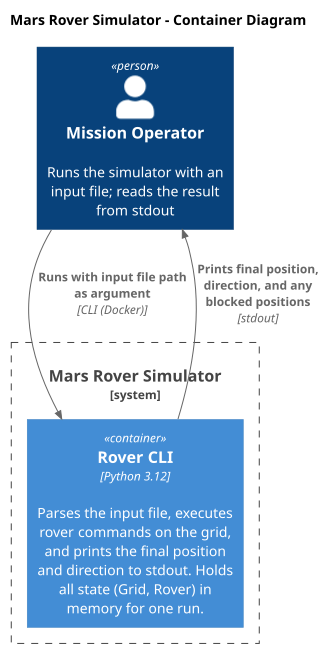
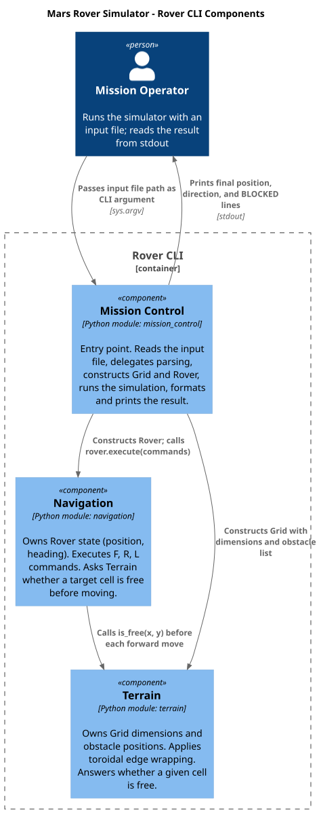

# 5. Building Block View

## 5.1 Container (C4 Level 2)

The Mars Rover Simulator is a single container: a Python CLI application that
runs in one process and holds all state in memory for the duration of that run.
There are no databases, no background services, and no network calls.



| Container | Technology | Responsibility |
|-----------|-----------|----------------|
| **Rover CLI** | Python 3.12 | Reads the input file, runs the simulation, prints the result. Holds all state (`Grid`, `Rover`) in memory for one run. |

## 5.2 Components of Rover CLI (C4 Level 3)

The Rover CLI is decomposed into three components, one per bounded context.
Each component is a Python module. The dependency rule from Chapter 4 is
enforced by import direction: `mission_control` imports both `navigation` and
`terrain`; `navigation` imports `terrain`; `terrain` imports nothing.



### Mission Control (`mission_control.py`)

The entry point and I/O boundary. Responsibilities:

- Parse `sys.argv` for the input file path.
- Read and validate the input file (see §4.4 for the format; 3 or 4
  blank-line-separated groups).
- Construct a `Grid` (Terrain) and a `Rover` (Navigation) from the parsed data.
- Call `rover.execute(commands)` to run the simulation.
- Collect `BLOCKED` events returned by Navigation and format them.
- Print the result to stdout (or an error to stderr with exit code 1).

Mission Control is the only component that touches the file system or stdout.
All domain logic is free of I/O and can be tested without it.

### Navigation (`navigation.py`)

Owns the rover's runtime state and all movement logic. Responsibilities:

- Represent the rover's current position `(x, y)` and heading (`N`, `S`, `E`, `W`).
- Turn right or left by rotating the heading 90°.
- For a forward command, compute the target cell (applying wrapping via
  Terrain's `Grid`) and call `grid.is_free(x, y)`.
  - If free: update position.
  - If blocked: record a `BLOCKED` event and leave position unchanged.
- Return the list of `BLOCKED` events and the final state to the caller.

Navigation has no knowledge of files, CLI arguments, or output formatting.

### Terrain (`terrain.py`)

Owns the static description of the grid. Responsibilities:

- Store grid `width` and `height`.
- Store the set of obstacle coordinates.
- Wrap any coordinate to the grid using modular arithmetic
  (`x % width`, `y % height`), so callers never need to handle edge cases
  themselves.
- Expose `is_free(x, y) -> bool` — returns `True` if the wrapped cell
  contains no obstacle.

Terrain is a pure data object with no dependencies on Navigation or Mission
Control. It can be constructed and queried in isolation in tests.

## 5.3 Module Structure

```
src/
├── mission_control.py   # Mission Control — entry point, I/O
├── navigation.py        # Navigation — Rover, Direction, Command
└── terrain.py           # Terrain — Grid, obstacle check, edge wrapping
tests/
└── ...                  # pytest test modules (added in Module 5)
```

Application code lives under `src/`; tests live under `tests/`. The Docker
build and run details are defined in Chapter 7.

## 5.4 Interface Summary

| Caller | Callee | Call | Returns |
|--------|--------|------|---------|
| Mission Control | Terrain | `Grid(width, height, obstacles)` | `Grid` instance |
| Mission Control | Navigation | `Rover(x, y, direction, grid)` | `Rover` instance |
| Mission Control | Navigation | `rover.execute(commands)` | `(final_state, blocked_events)` |
| Navigation | Terrain | `grid.is_free(x, y)` | `bool` |
| Navigation | Terrain | `grid.wrap(x, y)` | `(x, y)` |
