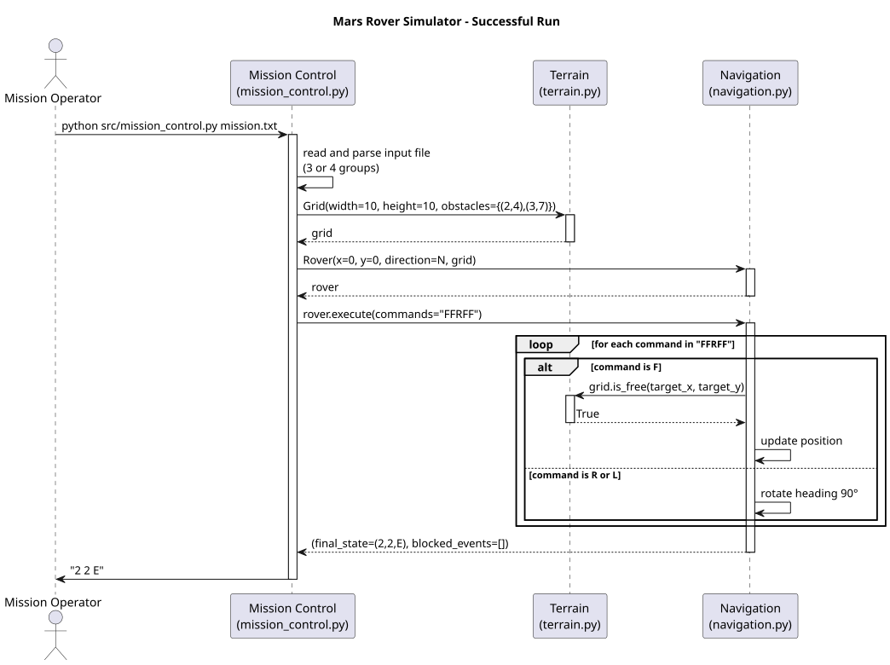
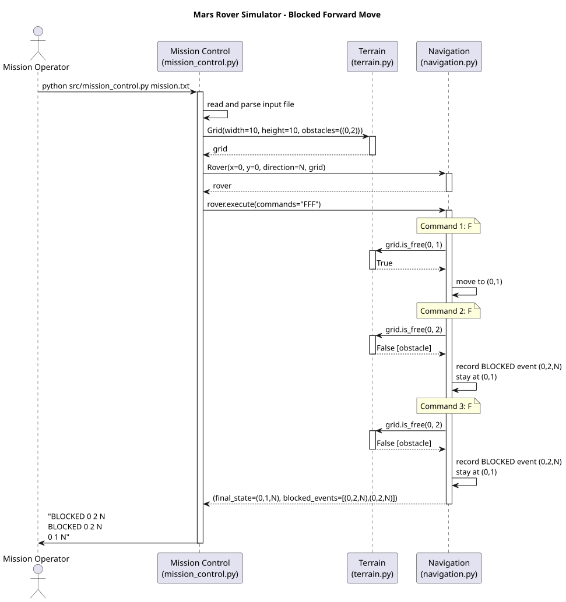
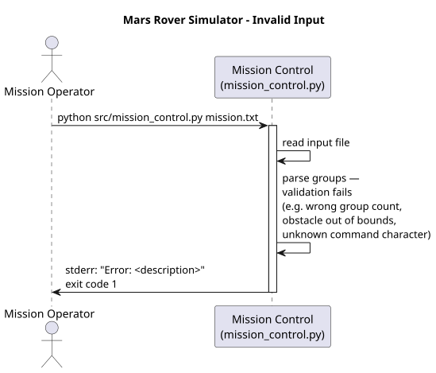

# 6. Runtime View

This chapter shows how the components interact at runtime for three key
scenarios. Each diagram traces the call sequence from the moment the operator
invokes the program to the moment it exits.

## 6.1 Scenario: Successful Run

A valid input file is provided. All commands execute without hitting any
obstacle. The rover reaches its final position and the program exits with
code 0.

**Key points:**

- Mission Control is the only component that reads the file or writes to stdout.
- `Grid` and `Rover` are constructed once and held in memory for the run.
- Navigation calls `grid.is_free()` before every forward move; Terrain answers
  without knowing why it is being asked.
- `rover.execute(commands)` is a single call; Navigation iterates over the
  command string internally.

## 6.2 Scenario: Blocked Forward Move

The rover encounters an obstacle on its current heading. The blocked command is
skipped, a `BLOCKED` event is recorded, and execution continues with the next
command. This scenario uses the exact example from §4.5: start (0,0,N),
obstacle at (0,2), commands `FFF`.

**Key points:**

- `grid.is_free()` returning `False` is the only mechanism that blocks a move.
  Navigation never inspects the obstacle set directly.
- One `BLOCKED` event is recorded per blocked command, not per obstacle.
  Commands 2 and 3 both attempt the same cell and each produces its own event.
- The final state `(0,1,N)` and both blocked events are returned together by
  `rover.execute()`; Mission Control formats and prints them.

## 6.3 Scenario: Invalid Input

The input file is malformed (wrong number of groups, an obstacle coordinate
outside the grid, an unknown character in the command string, or a missing
file). Validation fails inside Mission Control before any domain object is
constructed. The program prints a descriptive error to stderr and exits with
code 1.

**Key points:**

- Terrain and Navigation are never constructed on an invalid input; no partial
  state can leak.
- All validation happens in Mission Control, keeping domain objects free of
  defensive checks against malformed data.
- The error message names the specific violation so the operator can correct
  the input file.
